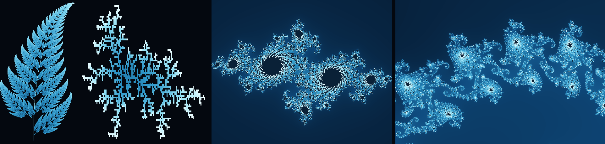

# web-3d-explore



Two independent tracks. They share no code.

## math/

Animated and interactive content on mathematics and neural-network foundations. One subject is a
topic.

| Topic | Subject | State |
|---|---|---|
| 0 | Imaginary numbers, from nothing | Pages built, no clips |
| 1 | Fractals | 69 clips, about 20 minutes; pages and applications built |
| 2 | Differential equations, attractors and chaos | Pages built, no clips |
| 3 | Calculus into a first neural network | Pages built, no clips |
| 4 | Tokens, embeddings and generation | Pages built, no clips |

**`math/01-fractals/`** is the video series: eleven modules, made with ManimCE at preview quality.
Every number on screen is computed by the scene that shows it.

```sh
cd math/01-fractals
pip install -r code2/requirements.txt
manim -pql code2/topic05.py FernIFS
```

**`math/web-math-fr/`** is the site: a FastAPI backend over PostgreSQL, a React and TypeScript
frontend on Vite with three.js, and a UI kit beside them whose config scripts set the whole look.
Every topic has its series, its interactive pages, its equations and its applications. Every
calculation a slider moves runs in the browser; one websocket route handles Mandelbrot zooms past
the point where single precision on the graphics card runs out. The commands for running, testing
and deploying it are in `math/web-math-fr/docs/commands.md`.

## web-s-r/

Real-time web transport and 3D rendering: websockets, WebRTC, three.js. Nothing built yet.

---

Rendered clips and Manim's intermediate output are not in the repository; every clip comes from
`code2/` by one command. The banner is rebuilt by `python math/01-fractals/tools/readme_banner.py`.
